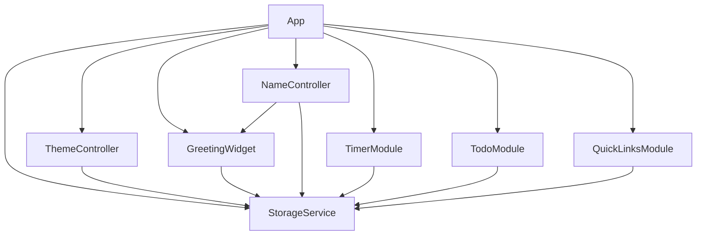
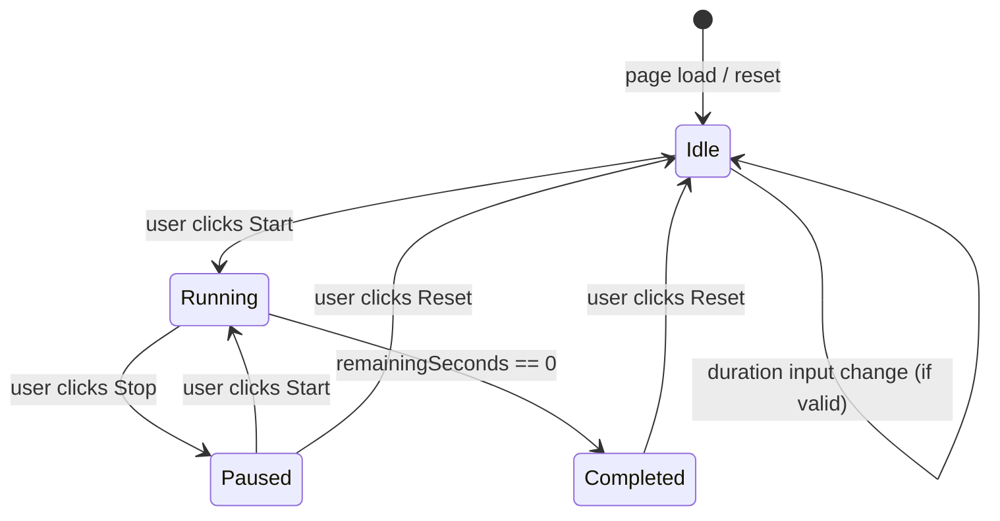
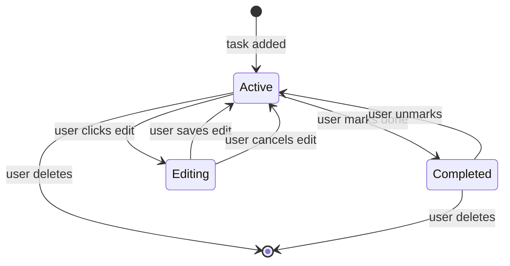

# Design Document: Personal Dashboard

## Overview

The Personal Dashboard is a standalone, single-page web application (no frameworks, no backend) that acts as a personal new-tab productivity page. It is built with plain HTML, CSS, and Vanilla JavaScript, with all persistent state stored in the Browser LocalStorage API.

The application delivers four core widgets in a single viewport:

| Widget | Purpose |
|---|---|
| Greeting_Widget | Current time, date, and time-of-day greeting with optional custom name |
| Timer | Pomodoro focus countdown with configurable duration |
| Todo_List | Task manager with add / edit / delete / mark-done and sorting |
| Quick_Links | User-defined website shortcuts that open in a new tab |

Three optional enhancements are included: light/dark theme toggle, custom name for the greeting, and adjustable Pomodoro duration.

**Key design principles:**
- Zero dependencies — everything ships in one HTML, one CSS, and one JS file.
- Resilient storage — every read from LocalStorage is wrapped in try/catch; corrupted entries are silently discarded and replaced with sensible defaults.
- Progressive enhancement — the UI remains fully functional even when LocalStorage is unavailable (with a visible warning).
- Module pattern — each widget is an IIFE-based module exposing a minimal public API, keeping state private and avoiding global namespace pollution.

---

## Architecture

### High-Level Architecture

The application follows a **controller–module** architecture without a virtual DOM or reactive framework.

```
index.html
├── css/style.css          ← single stylesheet (all themes, layouts, components)
└── js/app.js              ← single JavaScript file (all modules concatenated)
```

All JavaScript lives in `js/app.js` and is structured as a set of self-contained IIFE modules coordinated by a top-level `App` initializer that runs on `DOMContentLoaded`.

```
js/app.js
├── StorageService          ← thin LocalStorage wrapper (safe get/set/remove)
├── ThemeController         ← light/dark mode toggle + persistence
├── GreetingWidget          ← clock, date, greeting, custom name display
├── NameController          ← name input, validation, save/clear
├── TimerModule             ← Pomodoro countdown, start/stop/reset, audio alert
├── TodoModule              ← task CRUD, sorting, duplicate detection
├── QuickLinksModule        ← link add/delete/open
└── App.init()              ← orchestrates module initialization order
```

### Data Flow

```
User Interaction
       │
       ▼
  DOM Event Handler  (inside each module)
       │
       ├──► In-memory state update
       │
       ├──► DOM re-render  (module's own render function)
       │
       └──► StorageService.set(key, value)  (persist to LocalStorage)

Page Load
       │
       ▼
  App.init()
       │
       └──► Each module reads its data via StorageService.get(key, default)
            then renders initial state
```

No cross-module event bus is needed; modules are independent and only share `StorageService`.

---

## Components and Interfaces

### StorageService

Centralises all LocalStorage access. Every read is wrapped in `try/catch` so a corrupted value never crashes the app.

```js
const StorageService = (() => {
  const UNAVAILABLE = !isLocalStorageAvailable(); // tested once at startup

  function isLocalStorageAvailable() { /* try set/get/remove probe */ }
  function get(key, defaultValue) { /* try JSON.parse; return defaultValue on any error */ }
  function set(key, value) { /* try JSON.stringify + setItem; silent on error */ }
  function remove(key) { /* try removeItem; silent on error */ }
  function isAvailable() { return !UNAVAILABLE; }

  return { get, set, remove, isAvailable };
})();
```

**Storage Keys (constants):**

| Constant | Key String | Value Type |
|---|---|---|
| `KEY_THEME` | `pd_theme` | `"light"` \| `"dark"` |
| `KEY_NAME` | `pd_name` | `string` (1–50 chars) |
| `KEY_TIMER_DURATION` | `pd_timer_duration` | `number` (integer, 1–120) |
| `KEY_TASKS` | `pd_tasks` | `Task[]` (JSON array) |
| `KEY_SORT_PREF` | `pd_sort_pref` | `"default"` \| `"completed-last"` \| `"alpha"` |
| `KEY_LINKS` | `pd_links` | `Link[]` (JSON array) |

All keys are prefixed with `pd_` to avoid collisions with other origins' data sharing the same storage namespace in development.

---

### ThemeController

Manages theme state and applies it to the document root.

**Public API:**
```js
ThemeController.init()   // read saved theme, apply, wire toggle button
ThemeController.toggle() // swap theme, persist, re-apply
```

**Behaviour:** Applies the theme by toggling the `data-theme="dark"` attribute on `<html>`. All colour tokens are CSS custom properties under `[data-theme="dark"]` selectors in the stylesheet.

---

### GreetingWidget

Drives the clock, date, and greeting display. Updates every second via `setInterval`.

**Public API:**
```js
GreetingWidget.init()         // start clock interval, render initial state
GreetingWidget.refreshName()  // re-render greeting when saved name changes
```

**Greeting logic (pure helper):**

| Time range | Greeting text |
|---|---|
| 05:00 – 11:59 | Good Morning |
| 12:00 – 17:59 | Good Afternoon |
| 18:00 – 21:59 | Good Evening |
| 22:00 – 23:59 and 00:00 – 04:59 | Good Night |

Clock uses `Date` from the device. If `Date` construction throws or produces `NaN` the widget renders `--:--` and `"Date unavailable"` with no greeting.

---

### NameController

Handles the name configuration form.

**Public API:**
```js
NameController.init() // wire save button and input listeners
```

**Validation rules (enforced client-side before any storage write):**
- Empty / whitespace-only → reject, show inline error.
- Length > 50 characters → reject, show inline error.
- Valid → save to `KEY_NAME`, call `GreetingWidget.refreshName()`, flash "Saved!" confirmation.
- Clear (empty + save) → remove `KEY_NAME`, call `GreetingWidget.refreshName()`.

---

### TimerModule

Manages the Pomodoro countdown.

**Public API:**
```js
TimerModule.init()    // restore duration from storage, render initial display
TimerModule.start()   // begin or resume countdown
TimerModule.stop()    // pause countdown
TimerModule.reset()   // cancel countdown, restore to configured duration
```

**Internal state:**
```js
let configuredMinutes  // integer 1–120, sourced from storage or default 25
let remainingSeconds   // current countdown value
let intervalId         // setInterval handle, null when stopped
let isRunning          // boolean
```

**Timer tick implementation:** Uses `setInterval` at 1000 ms. Because `setInterval` can drift slightly, the implementation records `Date.now()` at start and adjusts `remainingSeconds` on each tick against elapsed wall-clock time, preventing accumulated drift across long sessions. `clearInterval` is always called before setting a new interval to prevent multiple concurrent intervals.

**Audio alert:** Uses `AudioContext` (Web Audio API) to synthesise a short beep when `remainingSeconds` reaches 0. This avoids the need to bundle an audio file and works cross-browser. Falls back silently if `AudioContext` is unavailable.

**Duration input validation:**
- Non-integer, < 1, or > 120 → reject, display inline error, retain previous value.
- Input is disabled while timer is running.

---

### TodoModule

Manages the task list with full CRUD and sorting.

**Public API:**
```js
TodoModule.init() // load tasks from storage, apply saved sort, render
```

**Internal state:**
```js
let tasks = []     // Task[] — authoritative in-memory list
let sortPref = 'default'
```

**Task lifecycle:**
1. **Add** — validate input (non-empty, ≤ 100 chars, no duplicate case-insensitive match) → push to `tasks` → persist → re-render.
2. **Edit** — replace `text` on matching task → persist → re-render.
3. **Delete** — splice from `tasks` by `id` → persist → re-render.
4. **Toggle done** — flip `completed` boolean → persist → re-render.

**Sort implementations:**
- `"default"` — stable sort by `createdAt` ascending (oldest first).
- `"completed-last"` — incomplete first (each group preserving `createdAt` order).
- `"alpha"` — case-insensitive alphabetical by `text`.

Sort is applied only to a *copy* of `tasks` for rendering; the stored array always keeps insertion order.

---

### QuickLinksModule

Manages the links panel.

**Public API:**
```js
QuickLinksModule.init() // restore links from storage, render
```

**Validation rules:**
- Name: 1–50 characters, non-empty.
- URL: 1–2048 characters, must begin with `http://` or `https://`.
- Max links: 50. Exceeding triggers inline error, no link added.

**Link click:** Opens URL in a new tab via `window.open(url, '_blank', 'noopener,noreferrer')`.

---

### App (Orchestrator)

```js
const App = {
  init() {
    if (!StorageService.isAvailable()) showStorageWarning();
    ThemeController.init();
    GreetingWidget.init();
    NameController.init();
    TimerModule.init();
    TodoModule.init();
    QuickLinksModule.init();
  }
};

document.addEventListener('DOMContentLoaded', App.init.bind(App));
```

---

## Data Models

### Task

```js
{
  id:          string,   // crypto.randomUUID() or Date.now().toString() as fallback
  text:        string,   // 1–100 characters
  completed:   boolean,  // false on creation
  createdAt:   number    // Date.now() timestamp (ms since epoch)
}
```

### Link

```js
{
  id:    string,  // crypto.randomUUID() or Date.now().toString() as fallback
  name:  string,  // 1–50 characters
  url:   string   // 1–2048 characters, must start with http:// or https://
}
```

### Stored Theme

Plain string: `"light"` or `"dark"`. Any other value (including missing) defaults to `"light"`.

### Stored Timer Duration

Plain integer (minutes). Non-numeric, out-of-range, or missing value defaults to `25`.

### Stored Sort Preference

One of `"default"`, `"completed-last"`, `"alpha"`. Any other value defaults to `"default"`.

### Stored Name

Plain string. If absent or fails validation rules (empty/whitespace, > 50 chars), treated as absent.

---

## CSS Architecture

All styles live in `css/style.css`. The stylesheet is organised into layers:

```
css/style.css
├── CSS Custom Properties  ← colour tokens for light/dark themes
├── Reset / Base           ← box-sizing, margin/padding resets, font
├── Layout                 ← CSS Grid dashboard layout (4 widget quadrants)
├── Greeting Widget        ← time, date, greeting typography
├── Timer Widget           ← countdown display, button states
├── Todo Widget            ← list, item, edit-in-place, sort controls
├── Quick Links Widget     ← link grid, add-link form
├── Theme Toggle           ← toggle button appearance
├── Utility classes        ← .hidden, .error-msg, .confirmation
└── Responsive overrides   ← media queries for 320px–2560px breakpoints
```

**Theme tokens example:**
```css
:root {
  --bg-primary: #ffffff;
  --text-primary: #1a1a1a;
  /* … */
}
[data-theme="dark"] {
  --bg-primary: #1a1a1a;
  --text-primary: #f5f5f5;
  /* … */
}
```

**Layout grid (≥1024px):**
```css
.dashboard-grid {
  display: grid;
  grid-template-columns: 1fr 1fr;
  grid-template-rows: auto auto;
  gap: 1.5rem;
}
```

Below 768px width, the grid collapses to a single column. At 320px the layout stacks vertically so all widgets remain scrollable and usable.

---

## Mermaid Diagrams

### Module Dependency Graph



### Timer State Machine



### Task Lifecycle



---

## Correctness Properties

*A property is a characteristic or behavior that should hold true across all valid executions of a system — essentially, a formal statement about what the system should do. Properties serve as the bridge between human-readable specifications and machine-verifiable correctness guarantees.*

### Property 1: Greeting text covers all hours without gaps or overlaps

*For any* integer hour value H in the range 0–23, the greeting function SHALL return exactly one of "Good Morning", "Good Afternoon", "Good Evening", or "Good Night" — never `null`, `undefined`, or an unrecognised string.

**Validates: Requirements 1.3, 1.4, 1.5, 1.6**

---

### Property 2: Custom name round-trip

*For any* valid name string (1–50 non-whitespace-containing characters), saving the name to LocalStorage and then reading it back SHALL return a string equal to the original input.

**Validates: Requirements 2.2, 2.3**

---

### Property 3: Name validation rejects invalid inputs

*For any* string that is empty, composed entirely of whitespace, or longer than 50 characters, the name validation function SHALL return a failure result and the storage SHALL remain unchanged.

**Validates: Requirements 2.5, 2.6**

---

### Property 4: Timer display is always valid MM:SS

*For any* remaining-seconds value S in the range 0–7200 (0 minutes to 120 minutes), the timer formatting function SHALL produce a string matching the pattern `MM:SS` where both components are zero-padded to two digits and SS is in 0–59.

**Validates: Requirements 3.1, 4.2**

---

### Property 5: Timer duration validation rejects out-of-range inputs

*For any* value that is non-integer, less than 1, or greater than 120, the duration validation function SHALL return a failure result and the configured duration SHALL remain unchanged.

**Validates: Requirements 4.5**

---

### Property 6: Task addition grows the list by exactly one

*For any* task list and valid task text (1–100 characters, not a case-insensitive duplicate of an existing task), adding that task SHALL increase the list length by exactly one and the new task SHALL appear in the list with the submitted text and `completed = false`.

**Validates: Requirements 5.3**

---

### Property 7: Task text validation rejects invalid inputs

*For any* string that is empty, composed entirely of whitespace, or whose case-insensitive form already exists in the current task list, the add-task validation SHALL return a failure result and the task list SHALL remain unchanged.

**Validates: Requirements 5.8, 5.9**

---

### Property 8: Task edit round-trip

*For any* task in the list and any valid replacement text (1–100 characters, non-empty, non-whitespace), editing the task and saving SHALL update the stored text to the replacement value while preserving `id`, `completed`, and `createdAt`.

**Validates: Requirements 5.6**

---

### Property 9: Sort does not mutate stored task order

*For any* task list and any sort option ("default", "completed-last", "alpha"), applying a sort SHALL NOT change the order of tasks returned by a subsequent raw storage read — only the rendered order SHALL differ.

**Validates: Requirements 6.2**

---

### Property 10: URL validation rejects non-http(s) prefixes

*For any* URL string that does not begin with `http://` or `https://`, the link URL validation function SHALL return a failure result and the link SHALL not be added to storage.

**Validates: Requirements 7.7**

---

### Property 11: Link addition is rejected when the cap is reached

*For any* links array already containing 50 entries, attempting to add one more link SHALL return a failure result and the links array length SHALL remain 50.

**Validates: Requirements 7.8**

---

### Property 12: LocalStorage serialisation round-trip for tasks

*For any* array of Task objects, serialising the array to LocalStorage via `JSON.stringify` and deserialising it via `JSON.parse` SHALL produce an array where each element's `id`, `text`, `completed`, and `createdAt` fields are deeply equal to the originals.

**Validates: Requirements 9.1, 9.2**

---

### Property 13: LocalStorage serialisation round-trip for links

*For any* array of Link objects, serialising then deserialising the array SHALL produce an array where each element's `id`, `name`, and `url` fields are deeply equal to the originals.

**Validates: Requirements 9.1, 9.2**

---

## Error Handling

### LocalStorage Unavailability

Detected once at startup by a probe write/read/remove cycle inside `isLocalStorageAvailable()`. If unavailable:
- A dismissible inline banner is shown at the top of the page.
- All modules operate in-memory only; data is lost on reload.
- No widget is disabled — the app remains fully interactive.

### Corrupted LocalStorage Values

`StorageService.get(key, defaultValue)` wraps `JSON.parse` in `try/catch`. On any error (SyntaxError, TypeError, etc.) it silently returns `defaultValue`. This means:
- Corrupted task array → empty task list shown.
- Corrupted links array → empty links panel shown.
- Corrupted theme value → light mode applied.
- Corrupted duration → 25-minute default used.
- Corrupted sort preference → default sort applied.

### Clock Unavailability

If `new Date()` returns `Invalid Date` (detected by `isNaN(date.getTime())`), the Greeting_Widget renders `--:--` for time and `"Date unavailable"` for the date, with no greeting text. The 1-second interval still fires to retry on each tick.

### Timer — Multiple Interval Guard

Before calling `setInterval`, `TimerModule.start()` always calls `clearInterval(intervalId)` to guarantee no stale interval persists. `intervalId` is reset to `null` whenever the timer is not running.

### Audio Alert Fallback

`AudioContext` creation is wrapped in `try/catch`. If the browser blocks or does not support `AudioContext`, the timer still reaches 00:00 and stops; only the audio alert is silently skipped.

### Input Validation Errors

All validation errors are shown as inline `<span>` elements adjacent to their input controls. They are cleared on the next user keystroke in the relevant field. No modal dialogs are used; errors never prevent interaction with other widgets.

---

## Testing Strategy

Because this project is pure static HTML/CSS/Vanilla JS with no build toolchain, the testing strategy is pragmatic: property-based tests and unit tests are written in a way that can run with minimal setup.

### Recommended Test Runner

**Vitest** (no framework dependency in production; test files are separate). Run with:
```
npx vitest --run
```

### Property-Based Testing Library

**fast-check** (MIT licence, zero production dependencies, works with Vitest).

Install for testing only:
```
npm install --save-dev vitest fast-check
```

Each property test MUST be configured to run at least **100 iterations** (`numRuns: 100`).

Tag format in test source:
```js
// Feature: personal-dashboard, Property N: <property text>
```

### Unit Tests

Focused on specific examples, edge cases, and integration points between modules.

**Priority areas:**
- `StorageService`: unavailability detection, corrupted JSON recovery, all CRUD paths.
- `GreetingWidget`: greeting text for each hour boundary (0, 5, 12, 18, 22, 23).
- `TimerModule`: boundary duration values (1, 25, 120), MM:SS formatting at edge values (0, 59, 3600, 7200).
- `TodoModule`: duplicate detection (case-insensitive), edit cancel, sort order stability.
- `QuickLinksModule`: URL prefix validation, 50-link cap enforcement.
- `NameController`: whitespace-only rejection, exactly-50-char acceptance, 51-char rejection.

### Property-Based Tests

Each Correctness Property maps directly to one property test.

| Property | Arbitary Generator |
|---|---|
| 1 — Greeting covers all hours | `fc.integer({ min: 0, max: 23 })` |
| 2 — Name round-trip | `fc.string({ minLength: 1, maxLength: 50 })` filtered for non-whitespace-only |
| 3 — Name validation rejects invalid | `fc.oneof(fc.constant(''), fc.string().filter(s => s.trim() === ''), fc.string({ minLength: 51 }))` |
| 4 — Timer display valid MM:SS | `fc.integer({ min: 0, max: 7200 })` |
| 5 — Duration validation rejects invalid | `fc.oneof(fc.float(), fc.integer({ max: 0 }), fc.integer({ min: 121 }))` |
| 6 — Task addition grows list | `fc.array(taskArb)` + `fc.string({ minLength: 1, maxLength: 100 })` |
| 7 — Task text validation rejects invalid | `fc.oneof(fc.constant(''), whitespaceStringArb, duplicateTextArb)` |
| 8 — Task edit round-trip | `taskArb` + valid replacement text arbitrary |
| 9 — Sort does not mutate stored order | `fc.array(taskArb)` + `fc.constantFrom('default', 'completed-last', 'alpha')` |
| 10 — URL rejects non-http(s) | `fc.string().filter(s => !s.startsWith('http://') && !s.startsWith('https://'))` |
| 11 — Link cap enforcement | 50-element link array arbitrary + one additional link arbitrary |
| 12 — Task serialisation round-trip | `fc.array(taskArb)` |
| 13 — Link serialisation round-trip | `fc.array(linkArb)` |

### Browser Compatibility

Manual smoke testing across Chrome, Firefox, Edge, and Safari to verify:
- All four core widgets render and are interactive.
- Theme toggle works correctly.
- Audio alert fires on timer completion.
- LocalStorage persist/restore works on reload.

### Accessibility

- All interactive controls have visible focus styles and ARIA labels or associated `<label>` elements.
- Inline error messages are linked to their inputs via `aria-describedby`.
- Theme toggle button has `aria-pressed` attribute reflecting the current state.
- WCAG 2.1 AA colour contrast compliance should be validated manually with a screen reader and contrast checker tool.
